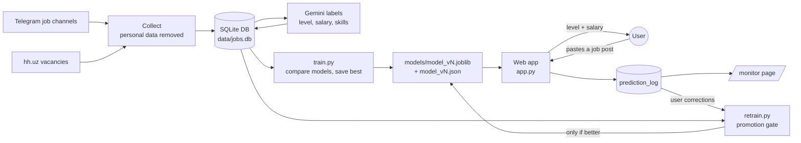
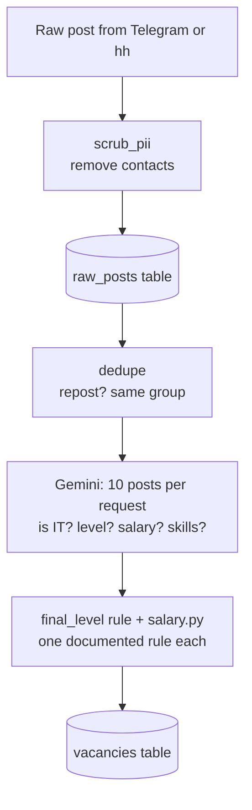
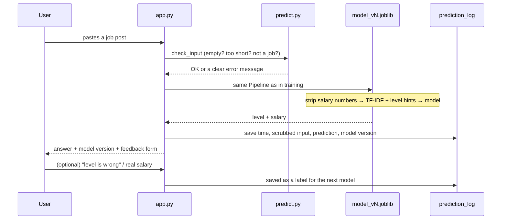
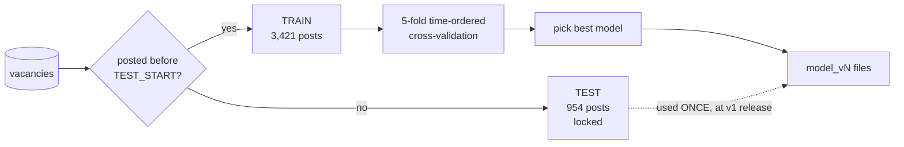
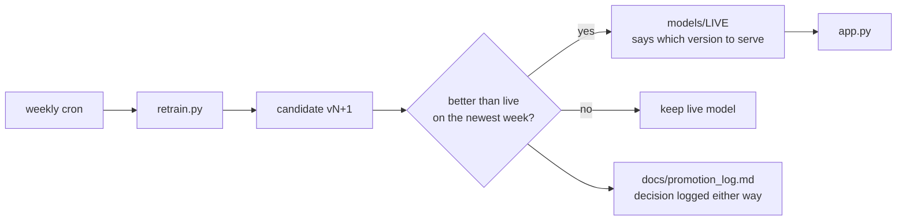
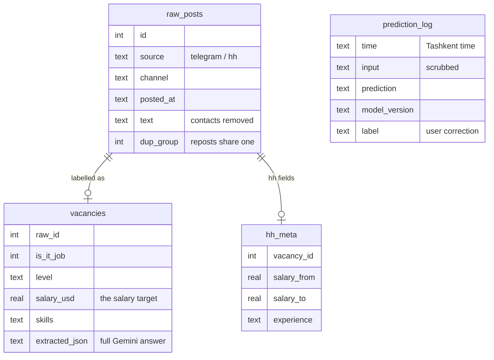

# Project guide: how everything fits together

**What it is:** paste an IT job post from Uzbekistan and get back its **level** (junior / middle / senior)
and an estimated **salary** (USD per month). Built for the career centre and for students.

**The rule behind it:** the models stay simple (course models only); the software around them is real.

---

## 1. The big picture



Two separate jobs:
- **Offline (once a week):** collect posts → label them → train / retrain.
- **Online (all the time):** the app answers users with the saved model. No LLM is used here.

---

## 2. The parts and where their code is

| Part | What it does | Code |
|---|---|---|
| **Collect: Telegram** | Reads public channel pages `t.me/s/<channel>` | `jobtracker/collect/telegram_web.py`, run with `scripts/collect.py` |
| **Collect: hh.uz** | Finds IT vacancy ids via hh's search, reads each page slowly and politely | `jobtracker/collect/hh_web.py` (crawling) + `hh_parse.py` (reading one page), run with `scripts/collect_hh.py` |
| **Privacy scrub** | Removes phones, e-mails, @usernames, links and names *before* anything is saved | `jobtracker/clean.py` → `scrub_pii` |
| **Dedupe** | Finds reposts of the same vacancy so they are counted once | `jobtracker/dedupe.py` |
| **Database** | All tables; `insert_post` is the only way posts get in (it removes personal data) | `jobtracker/db.py` (file: `data/jobs.db`, not in git) |
| **Labelling (Gemini)** | Turns each raw post into fields: is it IT, level, salary, skills. Data cleaning only | `jobtracker/extract/` (`schema.py` = the fields, `llm_extract.py` = the calls), run with `scripts/extract.py` |
| **Salary rule** | Converts any salary to USD per month (fixed rates, ranges → midpoint) | `jobtracker/salary.py` |
| **Train / test split** | Splits by date: posts from `TEST_START` onwards are the test set | `jobtracker/data.py`, date in `jobtracker/config.py` |
| **Models** | Every candidate as one scikit-learn Pipeline (baselines + course models) | `jobtracker/models.py` |
| **Metrics** | Macro F1, MAE, over-30% share: one definition for CV, test, gate and monitoring | `jobtracker/metrics.py` |
| **Training** | Cross-validation on the training part, saves the chosen models | `train.py` |
| **Model registry** | `models/model_vN.*` files, which version is live, "was the test set used?" | `jobtracker/registry.py` |
| **Serving** | Checks input, predicts, logs every prediction | `jobtracker/predict.py` |
| **Web app** | Pages: `/` predict, `/dashboard` job market, `/monitor` health of the model | `app.py` + `templates/` |
| **Monitoring** | Predictions per day, live error vs offline error | `jobtracker/monitoring.py`, `jobtracker/dashboard.py` |
| **Retraining** | Trains a new candidate; it replaces the live model only if it is better | `retrain.py` |
| **Weekly job** | Collect → label → retrain (cron, every Monday) | `scripts/weekly.py`, `deploy/crontab.txt` |
| **Deployment** | Server setup: auto-restart, HTTPS | `deploy/` (systemd + Caddy), `Dockerfile` |
| **Tests** | Data checks, parser, input checks, model smoke tests | `tests/` (run `python -m pytest`) |
| **Settings** | Channel list, test date, model names; secrets come from `.env` | `jobtracker/config.py`, `.env.example` |

---

## 3. What happens to one job post (offline)



Each post is labelled by Gemini **once** and the result is stored. Running it again only labels new posts.

---

## 4. How a prediction works (online)



---

## 5. Training and the rules that keep it honest



- **Split by date**, never random: the model must predict *future* posts.
- **The test set is opened once**, at the v1 release (`train.py --final`). Before that, every choice is made with cross-validation.
- **Leakage guard:** salary numbers are removed from the text before the model sees it, so it can't just read the answer.
- **Experiment log:** every run is a row in `docs/experiment_log.md`, failures included.

**The models compared:**

| Task | Dummy | Smart baseline | Course models | Best so far (CV) |
|---|---|---|---|---|
| Level | most frequent level | keyword rule ("senior", years) | Naive Bayes, Logistic Regression | LogReg + level hints, macro F1 **0.826** |
| Salary | median | median salary per title keyword | Ridge, kNN, Decision tree | Ridge + hints on log salary, MAE **$524** |

---

## 6. Model versions and the promotion gate



- `v0` = the two smart baselines (live now). `v1` = first real model, released in week 13.
- Versions are never overwritten. Roll back: `echo v0 > models/LIVE`.
- Retraining is switched off until v1 is released (until then the newest weeks are the test set).

---

## 7. Database tables (`data/jobs.db`)



`hh_skipped` (not drawn) remembers non-IT hh vacancies so they are never fetched again.

---

## 8. Commands you will actually use

```bash
pip install -r requirements.txt      # once
python -m scripts.collect            # new Telegram posts
python -m scripts.collect_hh            # new hh IT vacancies
python -m scripts.extract            # Gemini labels for new posts
python train.py --cv-only            # compare all models (nothing saved)
python app.py                        # open http://127.0.0.1:8000
python -m pytest                     # run the tests
```

---

## 9. Where the paperwork lives (`docs/`)

| File | What graders look for |
|---|---|
| `experiment_log.md` | Every training run + data changes |
| `error_analysis_level.md`, `error_analysis_salary.md` | 20 worst predictions and their causes |
| `decision_note.md` | Why we chose the metric and the v1 model |
| `release_checklist.md`, `model_card_v1.md` | Week-13 release |
| `monitoring_report.md`, `promotion_log.md` | Week-14 live results and v2 decision |
| `swap_and_break.md` | Another pair attacks our app |
| `data_plan.md`, `hh_permission.md` | Data sources and permissions |
| `architecture.md` | Longer system description |

**Still open:** hosting (a server), hand labels for checking Gemini (`docs/labels/hand_labels.csv`),
the v1 release in week 13, and 10 real users.
