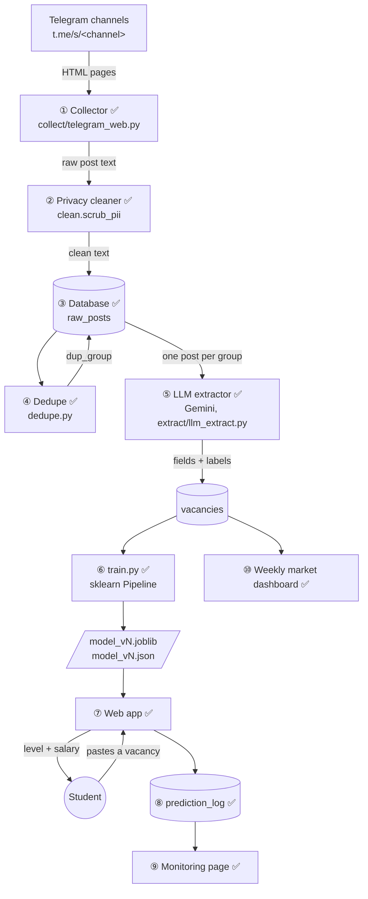
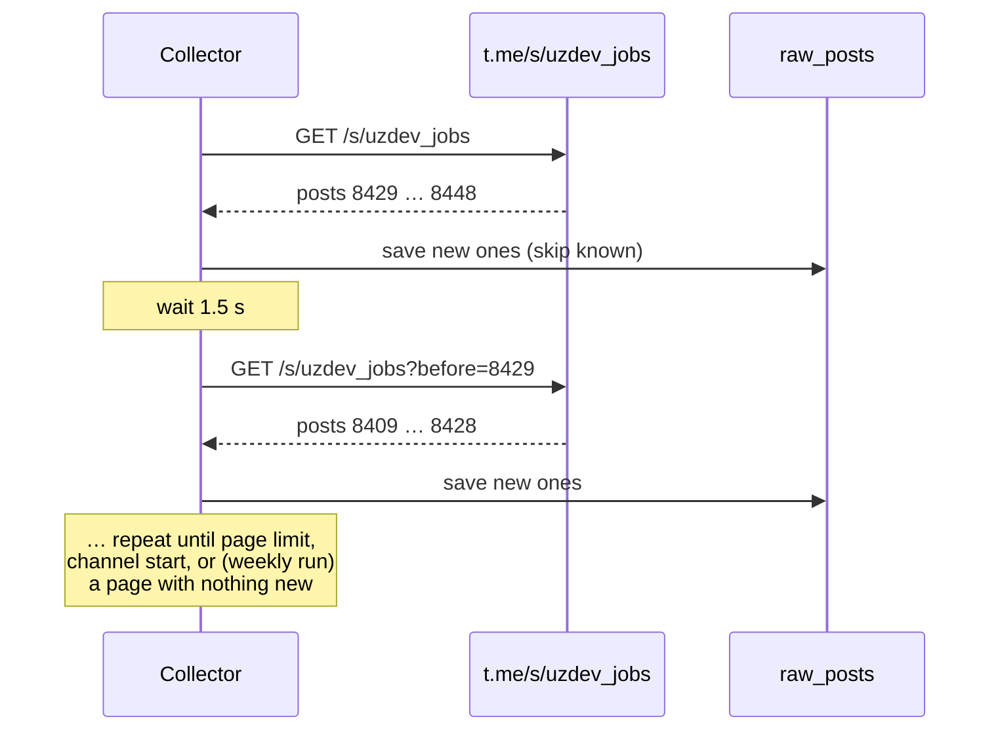
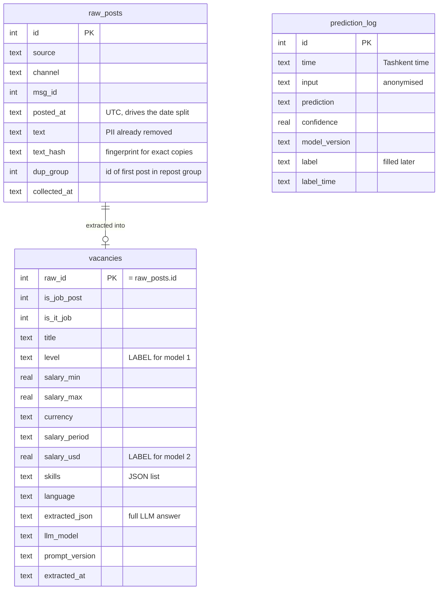
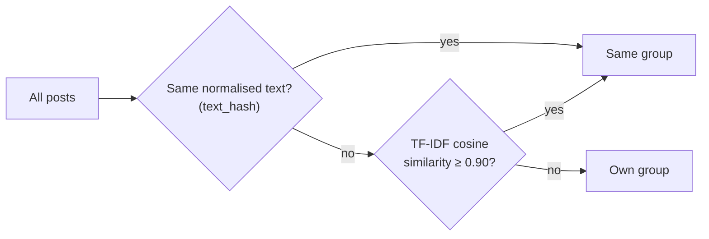
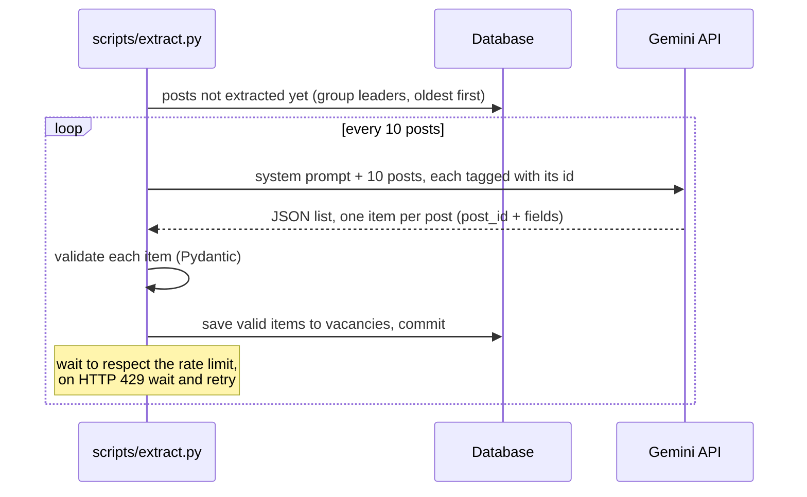
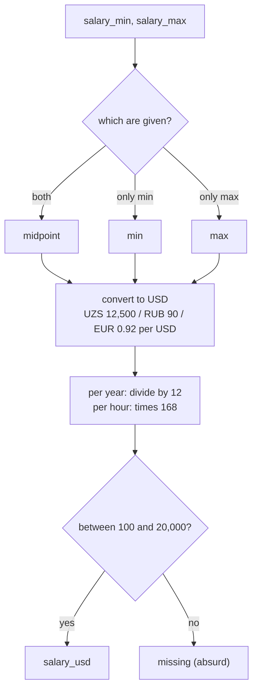
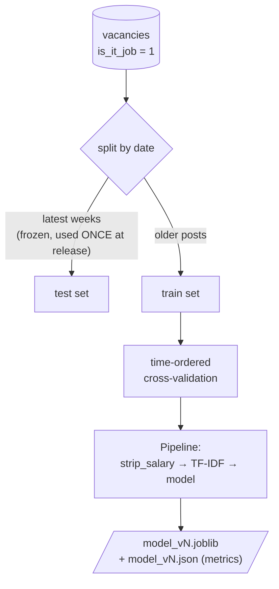
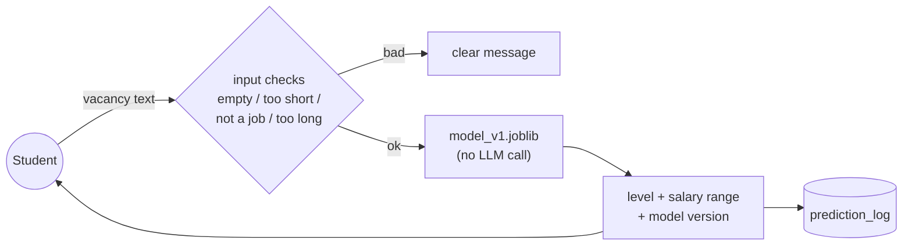
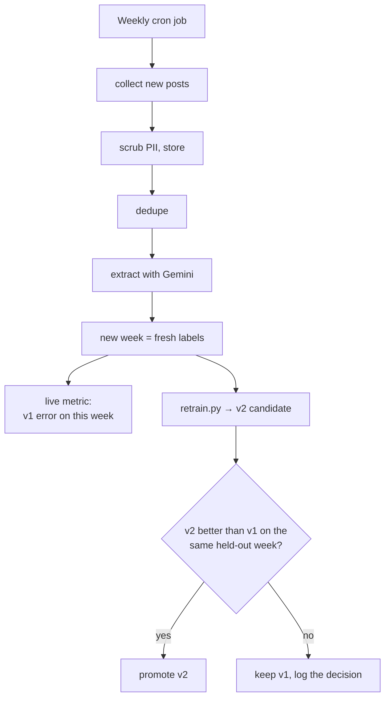

# How the system works

This page explains every part of the project: what each component does, how data moves
between them, and what is finished and what is still to build.
Diagrams use Mermaid; GitHub and DataGrip/IntelliJ show them as pictures.

**Status:** ✅ built and run · 🟡 built, waiting for the API key · ⬜ not built yet

---

## 1. The big picture



In one sentence: **we download public job posts, remove personal data, group reposts, let an
LLM turn each post into clean fields, train simple scikit-learn models on those fields, and
serve the models in a web app that logs every prediction.**

There are two separate "worlds":

| | Offline (data + training) | Online (serving) |
|---|---|---|
| Runs | once a week (cron) | every time a user sends a vacancy |
| Uses the LLM? | yes, to **create labels** | **no**, only the saved sklearn model |
| Output | rows in the DB, a new model file | a prediction + a log row |

The LLM is a data-cleaning tool. It never makes the prediction a user sees.

---

## 2. Components one by one

### ① Collector: `jobtracker/collect/telegram_web.py` ✅

**Job:** download posts from public Telegram channels.

Every public channel has a web version anyone can open without logging in, for example
`https://t.me/s/uzdev_jobs`. It shows the newest ~20 posts. Adding `?before=<post number>`
shows the 20 posts before that number. The collector walks back through the channel page by page:



From each post it keeps the **post number, date and text** (read from the page HTML with BeautifulSoup).

It **skips**:
- photo-only posts and texts under 40 characters (mostly ads),
- in `UstozShogird`, every post that does not start with "Xodim kerak" (employer wanted).
  The other posts there are **job seekers** advertising themselves with name, age and phone,
  so they are never stored.

**Politeness:** 1.5 s pause between pages, an honest User-Agent that says it is a course project.

**Two modes:**
- `--full`: backfill, go back up to `--pages` pages per channel (we used 150).
- default (weekly): stop at the first page where all posts are already in the DB.

Channels (in `jobtracker/config.py`): uzdev_jobs, uzpythonjobs, click_jobs, UstozShogird,
it_jobs_uz, itvakansiyalar.

### ② Privacy cleaner: `jobtracker/clean.py` → `scrub_pii()` ✅

**Job:** remove personal data **before** anything is written to disk (handbook rule 9).

```
"HR: Dilnoza  +998 90 123 45 67  hr@firm.uz  @firm_hr  https://t.me/firm"
                            │ scrub_pii
                            ▼
"HR: [name]  [phone]  [email]  [contact]  [link]"
```

| Removed | Example | Becomes |
|---|---|---|
| Contact-person names | `Mas'ul: Azizbek`, `Контактное лицо: Анна` | `[name]` |
| E-mails (also `x@gmail. com`) | `hr@firm.uz` | `[email]` |
| Links | `https://…`, `t.me/…` | `[link]` |
| Telegram usernames | `@firm_hr` | `[contact]` |
| Phone numbers (also broken ones) | `+998 90 123 45 67` | `[phone]` |

Salaries are **kept**, because they are labels.
`scripts/rescrub.py` re-applies the cleaner to the whole DB after a rule is improved and counts
leftovers. Current result: **0 leaks**.

### ③ Database: `jobtracker/db.py`, file `data/jobs.db` (SQLite) ✅



- `raw_posts`: one row per Telegram post. `(source, channel, msg_id)` is unique, so a post is
  never stored twice.
- `vacancies`: one row per extracted post (filled by ⑤).
- `prediction_log`: one row per app request (filled by ⑦).

Current numbers: **6,388 posts, 5,122 unique**, from Feb 2019 to Nov 2026.

**Not stored:** phones, e-mails, usernames, links, names, job-seeker posts, photos, view counts.

### ④ Dedupe: `jobtracker/dedupe.py` ✅

**Job:** find reposts of the same vacancy (same channel later, or another channel).



"Normalised" = lower-case, no hashtags, no punctuation or emoji.
Each group is named after its **earliest** post (`dup_group` = that post's id).

Why it matters:
1. **No leakage:** the same vacancy must not be in train *and* test. The split keeps whole groups together.
2. **No double cost:** only the first post of each group is sent to the LLM.

### ⑤ LLM extractor: `jobtracker/extract/` ✅

**Job:** turn a messy post (Uzbek/Russian/English, emoji, "1.5 mln so'm", "от 2000$") into the
same clean fields every time. These fields become our **labels**.

Model: Google **Gemini `gemini-3.5-flash-lite`**, free tier (key in `.env` as `GEMINI_API_KEY`).



- **`schema.py`** holds the rules: the fields (`Extraction`) and the prompt (`SYSTEM_PROMPT`).
  The SDK turns the Pydantic model into a JSON schema, so Gemini must answer in exactly that shape.
- **10 posts per request:** the free tier counts *requests*, so packing posts lets ~5,000
  posts go through in ~513 requests.
- **Resumable:** progress is saved after every request. If the daily quota runs out, the script
  stops; running it again continues with the posts still missing. A post is never paid twice.
- **Traceability:** every row stores the full answer (`extracted_json`), the model name and
  `PROMPT_VERSION`. A prompt change means a new version number and a note in the experiment log.
- **Privacy:** only already-scrubbed text is sent (free-tier data may be used by Google).

The fixed **label rules** written into the prompt:

| Field | Rule |
|---|---|
| `is_job_post` | an employer hiring; not ads, courses, events, job seekers |
| `is_it_job` | dev, data/ML, QA, DevOps, security, UI/UX, IT PM, sysadmin |
| `level` | the LLM reports the level named in the post and the required years (0 for "no experience"); then **code** (`final_level`) applies the rule: 1) named level wins → 2) else years: <1 junior, 1–3 middle, 3+ senior → 3) else `unknown` |
| salary | range → min & max; "from X" → min only; "up to Y" → max only; "negotiable" → empty |
| `skills` | concrete technologies with normalised names ("Postgres" → "PostgreSQL") |

### Salary rule: `jobtracker/salary.py` ✅

Every salary becomes **one number: USD per month** (`salary_usd`, the regression label).



### Leakage guard: `clean.strip_salary()` ✅

The post text contains the salary itself ("Зарплата: 2000$"). If the model could read it, it
would "predict" the salary by copying it. So before training **and** before serving, amounts and
currency words are removed from the model input:

```
"Senior Python, 3+ years, зарплата от 2500$"  →  "Senior Python, 3+ years, зарплата от"
```

Small numbers like "3+ years" stay: experience is a fair signal for level.

### ⑥ `train.py` ✅

**Job:** rebuild the models from the database in one command.



| | Level (classification) | Salary (regression) |
|---|---|---|
| Label | `level` (unknown excluded) | `salary_usd` (posts that state one) |
| Metric | macro F1 | MAE in USD |
| Dummy | most frequent level | median salary |
| Smart baseline | keyword → level rule | median salary per title keyword |
| Course models | MultinomialNB, LogReg | LinReg, kNN, Decision Tree |

Every run goes into `docs/experiment_log.md` (CV scores only, failures kept).

### ⑦ Web app ✅ (`app.py`; hosting still to set up)



The page tells users what is logged and why.

### ⑧–⑨ Prediction log and monitoring ✅ (`/monitor`, feedback form, `retrain.py`)

Every request writes a row: time (Tashkent), anonymised input, prediction, confidence, model
version. The **label** is filled later, when the same vacancy shows up in a week's collected
data or a user corrects it. The monitoring page shows predictions per day, live error per new
week next to the offline error, and unusual inputs.

### ⑩ Weekly market dashboard ✅ (`/dashboard`)

Built straight from `vacancies`: top skills this week, salary by level, postings per week.

---

## 3. The weekly cycle (after release)



Retraining is gated: v2 replaces v1 **only** if it wins on the same held-out data.

---

## 4. Files at a glance

| File | Component | Status |
|---|---|---|
| `jobtracker/config.py` | channels, paths, model name, prompt version | ✅ |
| `jobtracker/db.py` | tables | ✅ |
| `jobtracker/collect/telegram_web.py` | ① collector | ✅ |
| `jobtracker/clean.py` | ② privacy cleaner, normalise, leakage guard | ✅ |
| `jobtracker/dedupe.py` | ④ reposts → groups | ✅ |
| `jobtracker/extract/schema.py` | ⑤ fields + prompt (label rules) | ✅ |
| `jobtracker/extract/llm_extract.py` | ⑤ Gemini calls, saving | ✅ |
| `jobtracker/salary.py` | salary → USD/month | ✅ |
| `scripts/collect.py` | runs ① ② ④ | ✅ |
| `scripts/extract.py` | runs ⑤ | ✅ |
| `scripts/rescrub.py` | re-applies ② to the whole DB, counts leaks | ✅ |
| `tests/` | 10 checks for cleaning, salary and schema rules | ✅ |
| `train.py`, `retrain.py`, `app.py`, `jobtracker/{models,predict,monitoring,dashboard}.py` | ⑥–⑩ | ✅ |
| `deploy/`, `Dockerfile` | hosting | ⬜ server not chosen yet |

## 5. Commands

```bash
source .venv/bin/activate
python -m scripts.collect                 # new posts (first time: --full --pages 150)
python -m scripts.extract --dry-run       # how many posts wait for the LLM
python -m scripts.extract --limit 20      # small test, check rows in DataGrip
python -m scripts.extract                 # everything; re-run next day if quota ends
python -m scripts.rescrub                 # after improving a privacy rule
python -m pytest                          # all checks
```
